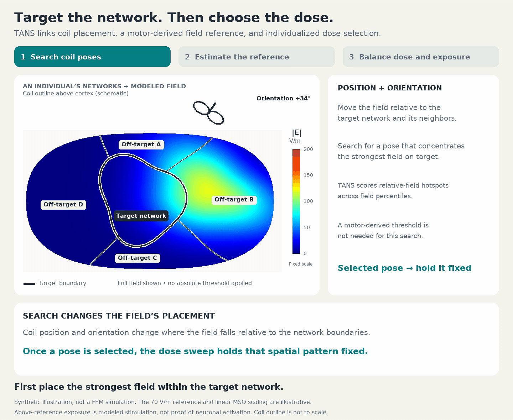
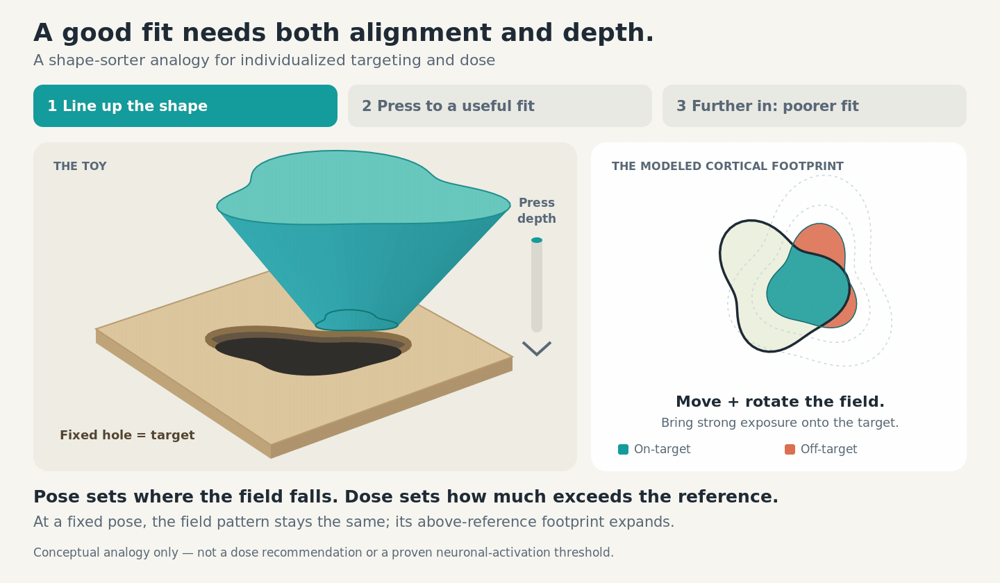
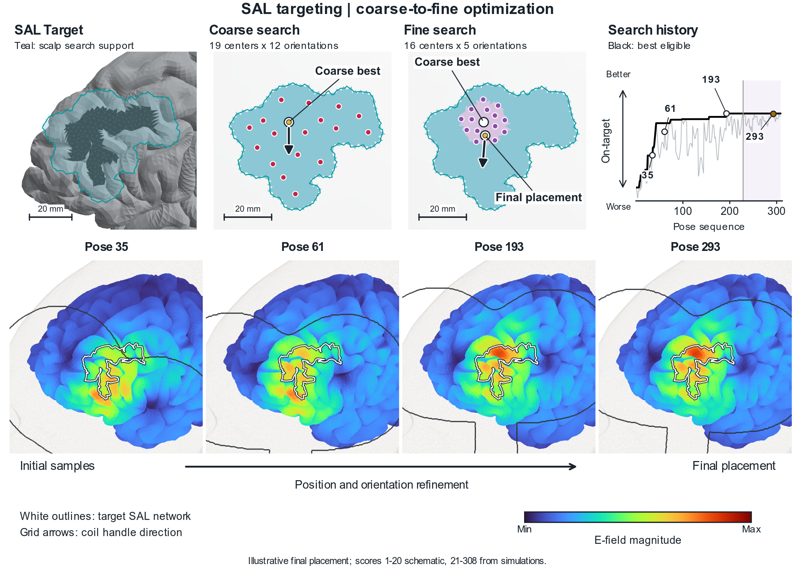
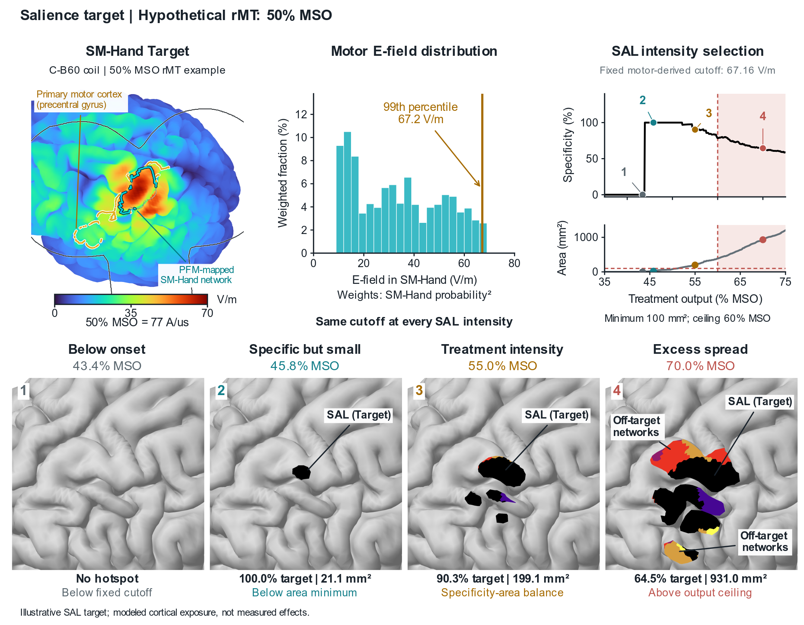
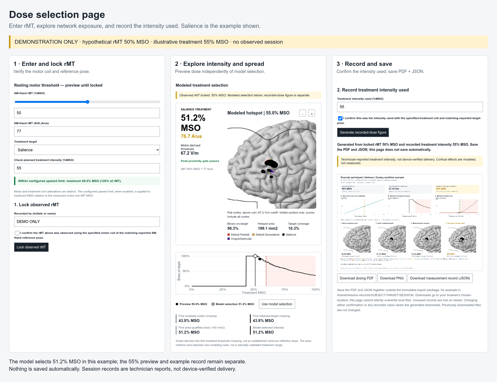
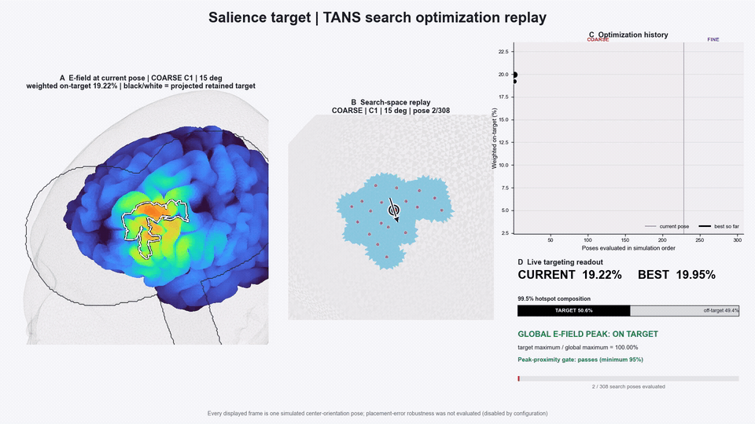

# Output gallery

The homepage features the selected SAL optimization and dosing grant figures,
and a search movie rendered from the **same Salience target and saved run**.
SAL / DLPFC is illustrative, not a restriction. In principle, any compatible
network or weighted target pattern and any cortical zone can be configured;
practical targeting still depends on anatomy, coil access, and field reach.
The exact grant layouts are curated documentation assets, not automatic
replacements for the pipeline's reports. These are model visualizations,
not measured stimulation outcomes.

## Targeting and dose: the TANS sequence



[Full-resolution MP4](assets/targeting-dose-field-scaling.mp4) ·
[Still image](assets/targeting-dose-field-scaling.png) ·
[Four-frame storyboard](assets/targeting-dose-field-scaling-storyboard.png).

1. **Search coil position and orientation.** The unthresholded field moves with a
   schematic coil above the fixed network boundaries, then turns the coil at a fixed position to show how orientation changes the
   field. It settles on a pose concentrating its strongest field within the target network. Actual TANS pose
   scoring uses relative-field hotspots across field percentiles; this animation
   does not replay optimizer scores or FEM solutions.
2. **Estimate the motor-derived field reference.** At the selected pose, introduce
   an illustrative 70 V/m reference. Its derivation is a separate motor-calibration
   procedure, explained in the
   [rMT / E-field procedures](calibration_to_treatment_dose.md).
3. **Compare doses at the fixed pose.** At 36% MSO, specificity is 100% but target
   coverage is only about 4%. Increasing intensity exposes more target cortex,
   then increasingly includes off-target networks. The normalized field pattern
   remains identical throughout the dose sweep.

The final illustrative selection is **48.6% MSO**: maximum binary specificity
among doses meeting a minimum total-hotspot area, with an 80% illustrative
output ceiling and a lowest-dose tie break. Here the minimum area is deliberately
set to half the schematic target's area; this is **not a shipped study setting**
or a minimum target-coverage rule. The schematic matches the selector's
constraint logic without implying that TANS maximizes coverage or jointly
optimizes pose and intensity.

The target and off-target networks A–D are synthetic. The 70 V/m reference,
linear MSO-to-field relationship, and dose constraints are illustration choices.
Above-reference exposure does not establish neuronal activation or clinical
benefit. Real dosing requires matched hardware calibration and the study's
configured criteria. The [SimNIBS field-scaling explanation](https://simnibs.github.io/simnibs/build/html/faq.html#what-is-the-di-dt-in-tms-simulations)
describes the relationship between field strength and coil-current slew rate.

The 36-second loop is generated by
[`tools/render_targeting_dose_field_scaling.py`](../tools/render_targeting_dose_field_scaling.py)
with NumPy, Pillow and FFmpeg.
[Assumptions and checks](diagrams/targeting-dose-field-scaling.json).

## Option 1: the shape-sorter analogy



[Still image](assets/targeting-dose-concept.png) ·
[Editable SVG still](diagrams/targeting-dose-concept.svg).

First align the shaped peg with the hole; then press it in until a wider section
starts to fit poorly. The fixed hole represents the target. The plan view links
alignment to on-target exposure, then shows the above-reference footprint
growing as intensity rises. Teal denotes target exposure and coral off-target
exposure in this **conceptual** diagram; these are not the atlas colors used in
the scientific SAL figures below.

At a fixed coil pose, increasing intensity scales the same field pattern. It is
the region above a fixed motor-derived reference that expands—not a deformation
of the normalized E-field or a demonstrated boundary of neuronal activation.
The toy is an analogy, not a mechanical model of TMS or a prescribed stopping
rule. A good modeled tradeoff need not fill a target completely or avoid every
off-target vertex. The diagram contains no participant data.

The 14-second loop is generated from vector geometry by
[`tools/render_targeting_dose_concept.py`](../tools/render_targeting_dose_concept.py),
using system Python with Rsvg/pycairo and FFmpeg. It does not run simulations.

## Coarse-to-fine optimization



[Optimization PDF](assets/sal-optimization.pdf).

The example uses **19 centers × 12 orientations** in the coarse search and
**16 centers × 5 orientations** in the fine search: 308 simulated candidate poses.
The teal contour links target support to the scalp search space; grid arrows
show coil-handle direction. The numbered field panels are actual simulations.

Two presentation choices matter for this particular grant layout:

- History scores **1–20 are schematic**; scores 21–308 retain the simulated
  values and original execution order. The black line is the running eligible
  maximum of this displayed series.
- The figure's **“Final placement” is an illustrative adjacent candidate**
  (pose 293, fine center 13, 175°), not the optimizer's winner (pose 229,
  fine center 1, 0°). The two positions are about 5.65 mm apart.

These choices affect the illustration only: saved scores and pipeline selection
are unchanged. Normal run outputs include
`targets/<target>/reports/target-selection/TargetSelectionSearchSummary.png`
and `targets/<target>/reports/optimal-pose/OptimalPoseOverview.png`.

## Electric-field dose adjustment



[Dosing PDF](assets/sal-dosing.pdf).

This is the **55% MSO, network-colored, direct-label** variant, with a
**100 mm² minimum-hotspot** criterion. It uses the actual fine-search winner from the same SAL run,
not the adjacent candidate labeled final in the optimization layout.

The example uses a hypothetical rMT of **50% MSO**, a motor-derived **67.16 V/m**
cutoff, and limits candidate treatment intensity to **60% MSO**. Maximizing binary
target specificity among feasible intensities, with the lowest-MSO tie break,
selects **51.2% MSO**. The displayed treatment comparison is instead **55% MSO**:
**199.1 mm²** of hotspot, **90.3%** within the binary target. It is a deliberately
chosen illustration, not the computed optimum. SAL is black; other exposed
networks retain their individual colors and are explicitly grouped by the
“Off-target networks” callouts. These percentages describe hotspot specificity,
not coverage of the whole network or probability of clinical response.

This is an **example using hypothetical rMT**, not a treatment prescription or
delivered-intensity record. The 100 mm² minimum is an illustration choice,
not a change to shipped study settings. The 70% MSO panel shows excess spread
beyond the example ceiling, not a recommended setting.

### Why intensity changes the hotspot

Coil optimization determines the field's placement and relative spatial pattern.
Dosing then asks which parts of that field exceed a fixed motor-derived reference.
At low intensity, little target cortex may cross that reference; increasing
intensity exposes more target cortex, but can also recruit adjacent networks into
the modeled hotspot. The objective is sufficient modeled exposure with good
network specificity, not simply the largest or strongest field. This is why
TANS links individualized network targeting to intensity selection. See the
[targeting-and-dose rationale](calibration_to_treatment_dose.md) for calibration
logic, the difference between relative and absolute hotspots, and assumptions.

### Dose selection page



The dose selection page supports any configured treatment target. This
walkthrough uses the **same SAL target, selected field, motor reference,
and calibration** as the dosing figure. It renders the current production HTML
interface with hypothetical 50% rMT and 55% treatment MSO. The interface's model
selection remains 51.2% MSO. Source files and subject exports are unchanged;
example confirmations were performed only in an isolated documentation browser,
and no session PDF/JSON downloads were saved or represented as measurements.

Open the treatment target's
`shared/export_<subject>/<target>/dose-calibration/DoseCalibrationReport.html`.
Lock the observed rMT at the matching motor pose, then separately confirm the
treatment intensity used. The current HTML workflow generates a session figure
and PDF/PNG/JSON downloads distinguishing model selection from reported intensity.
These browser downloads follow confirmation, not pre-session processing, and do
not overwrite the operator package. See [measured-dose records](measured_dose_records.md).

The grant figure illustrates the dosing concept; it is **not** a screenshot of
the session figure and does not imply that this exact layout is generated on lock.

## Watch the SAL search



[Watch or download the full-resolution MP4](assets/sal-search-replay.mp4).

The movie uses the **same run as the SAL optimization and dosing figures**:
**228 coarse + 80 fine poses**. The 1920 × 1080 MP4 retains every candidate at 12 frames/s, plus
stage/final holds and a final-prescription frame. The 960-pixel-wide GIF samples
the same timeline at 4 frames/s; use the MP4 for every pose and readable labels.

Its synchronized views show:

- Modeled E-field and retained-target outline at the current simulated pose.
- Coil position and handle orientation within the scalp search space.
- Weighted on-target score history and best-so-far trace.
- Binary hotspot composition and target/global-peak checks. The displayed 95%
  peak-proximity gate is distinct from the “global peak on target” status.

Unlike the grant layout, the movie uses **actual scores throughout** and ends
at the **actual fine-search winner** (pose 229). It replays saved simulations
in search order; it is not a live solver recording, and playback speed is not
compute time. Placement-error robustness was **not evaluated** in this run;
the movie states that explicitly. No new FEM simulations are needed to render it.

### Where the movie lives after a run

The reports stage automatically renders each completed target's replay and
links it from the reports. Under `targets/<target>/reports/search-replay/`:

| File | Purpose |
| --- | --- |
| `SearchOptimizationReplay.mp4` | Full-resolution search movie |
| `SearchOptimizationReplay.json` | Settings, counts, and interpretation |
| `SearchOptimizationReplayFrames.tsv` | Rendered-pose sequence and scores |
| `ReplayFrame_pose_*.png` | Selected still frames |

The GIF is a documentation preview, not a standard pipeline output. Changing
replay frame rate changes playback, not search density or simulation results.
See the [workflow](WORKFLOW.md) for the reports stage.

## Choose your own target and cortical zone

The target representation and anatomical search mask define the study's target;
neither SAL nor DLPFC is hard-coded as the only option. Changing a network name
alone does not change the default left-prefrontal search region. Supply a custom
mask for another cortical zone, and review its target intersection and modeled
field reach. See [network and search-region configuration](CONFIGURATION.md#network-and-anatomical-search-region)
and [WTA / weighted-target inputs](NETWORK_INPUTS.md).

## Other automatic outputs

| Output | Location / interpretation |
| --- | --- |
| Selected-pose field and target review | `targets/<target>/reports/optimal-pose/OptimalPoseOverview.png` |
| Relative-field threshold sweep | `targets/<target>/reports/optimal-pose/OptimalPoseThresholdSweep.gif` |
| Hotspot network composition | `targets/<target>/reports/optimal-pose/HotspotNetworkComposition.png` |
| Available fine/robust comparisons | Linked by the master report and `reports/PoseVariants.json`; robustness-dependent |
| Prescribed navigation overview | Inside `shared/export_<subject>/<target>/`, matched to the sole configured trajectory |
| Offline dose exploration | Inside each treatment target's operator `dose-calibration/` folder, when a motor pairing exists |

## Technical provenance and publication review

The [asset manifest](assets/manifest.json) records fingerprints, renderers, and
illustrative assumptions for the SAL example and the conceptual animation. The static
layouts preserve the selected grant figures' scientific panels and numeric values.
Only presentation text was adjusted to
use generic network titles and “Hypothetical rMT”; PNG/PDF files were exported
from those vectors. The workpage walkthrough uses captured production UI
components, rearranged into three explanatory panels, with hypothetical values
and a generic participant label. Its renderer is
[`tools/render_dose_workpage.mjs`](../tools/render_dose_workpage.mjs).
The movie uses the production replay renderer with a generic Salience title
and parallel frame rendering; its candidate order, target maps, fields, scores,
and final selection come from that same saved run.

For reproducibility, the SAL illustration's target preparation used a 6 mm
geodesic dilation of the original binary support, extending nearest-seed
weights. It is an illustrative target construction, not an unchanged measured
network boundary or a new pipeline default. The grant history presentation and
hypothetical-rMT assumptions are described above. No study configuration or
source subject files were changed for this gallery update.

These assets contain participant-derived cortical/head anatomy. Direct subject
labels are omitted from the displayed figures/movie, but this is **not a
certification of anonymity**. Review sharing permission before a public commit
or push. Private source paths, raw MRI, meshes, navigation coordinates, and
session JSON are not included in the curated assets.

The grant-layout scripts and private inputs are not shipped here. Existing
`tools/render_readme_cortex.py` and `tools/render_readme_dose.mjs` remain available
for alternative documentation examples, but did not produce these grant figures.
The production movie renderer is
[`search/render_search_optimization_replay.py`](../search/render_search_optimization_replay.py).

To make an equivalent preview from an authorized, completed movie (requires
FFmpeg; use a new output filename):

```bash
ffmpeg -n -i SearchOptimizationReplay.mp4 \
  -filter_complex '[0:v]fps=4,scale=960:-1:flags=lanczos,split[a][b];[a]palettegen=stats_mode=diff[p];[b][p]paletteuse=dither=bayer:bayer_scale=3' \
  -loop 0 sal-search-replay.gif
```

Inspect all media and captions before publication. Do not copy an entire subject
run or operator package into the public documentation directory.
